<div align="center">

# AURA / MFT LENS

**从一份证据，进入文件系统的深处。**

Windows `$MFT` / USN Journal 离线分析 · 原始字节追溯 · 驻留文件提取

[](https://github.com/JasmineAura/AuraPrefetchLens/releases/latest)


[下载软件](https://github.com/JasmineAura/AuraPrefetchLens/releases/latest) · [功能介绍](#功能介绍) · [从源码运行](#从源码运行) · [打赏作者](#打赏作者)

</div>

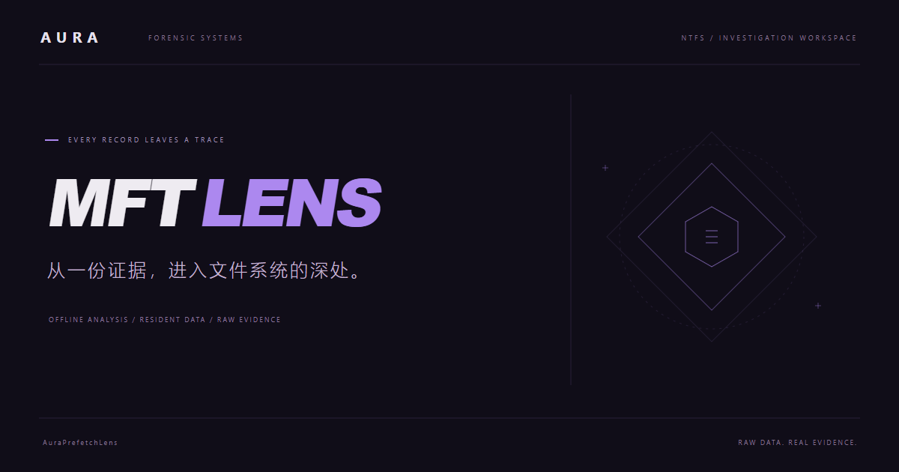

## 项目简介

AuraPrefetchLens 支持 **Windows NTFS 主文件表 `$MFT` 与 USN Journal `$UsnJrnl:$J`** 的离线调查，适用于应急响应、数字取证和 CTF 分析。

使用 Tauri 2、Rust 与 React 构建，采用斜切几何、大字排版和持续环境动效。主界面分为左右两段：左侧选择证据并解析，右侧在完成后展开操作。记录结果在独立窗口展示，分类通过窗口内的标签切换。

提供 **曜石紫、午夜蓝、绯红黑** 三套深色主题和 **瓷白紫** 亮色主题，支持窗口间同步。点击右上角太阳 / 月亮按钮即可在亮色和上次使用的深色主题之间切换，选择会自动保存。动效可以关闭，并遵循系统的“减少动态效果”设置；界面不使用游戏素材。

## 界面预览

以下功能截图来自程序实际解析的演示用 MFT，不包含真实用户文件数据。点击图片可以查看大图。

### 双段主界面

左侧导入证据，右侧在解析完成后展开记录统计与操作入口。


### 独立分析窗口

六个分类标签、分页搜索与证据摘要集中在独立窗口中。

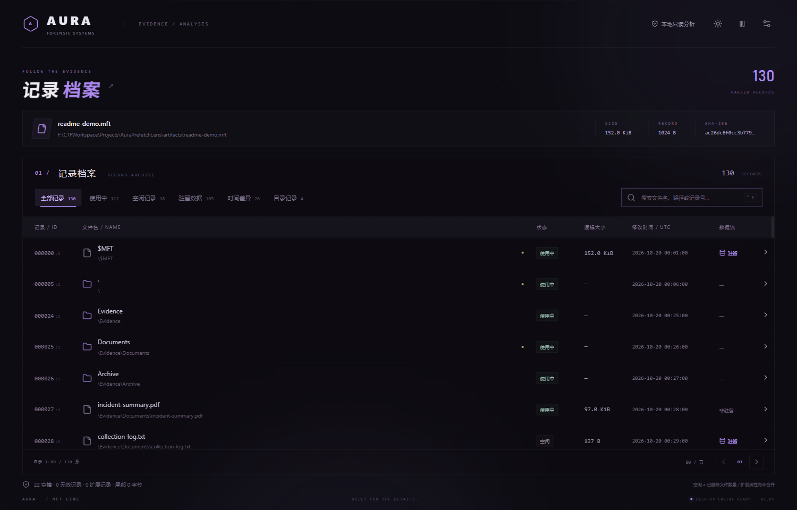

### 记录调查与驻留提取

| SI / FN 时间与记录详情 | 驻留内容预览与提取 |
| --- | --- |
| 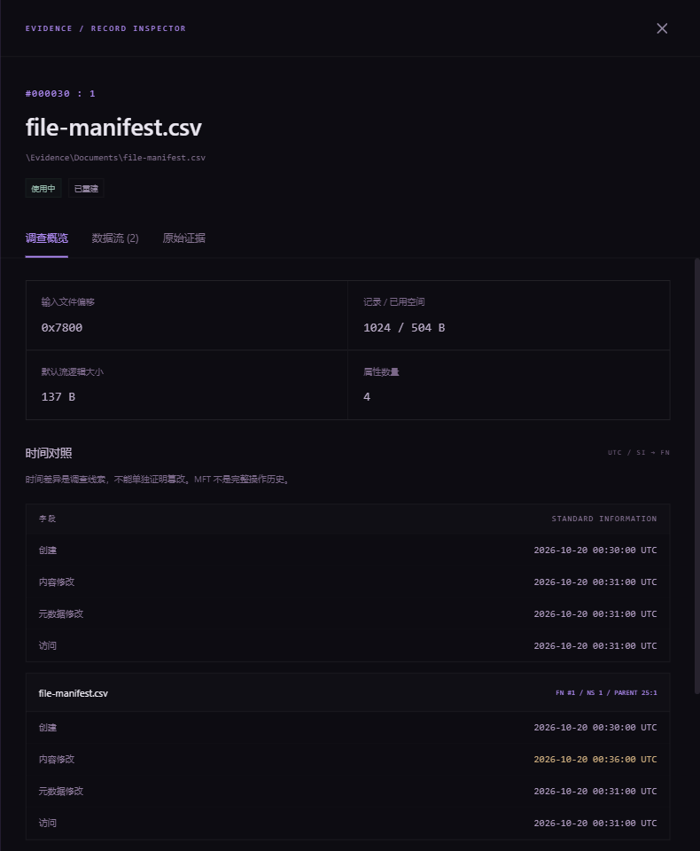 | 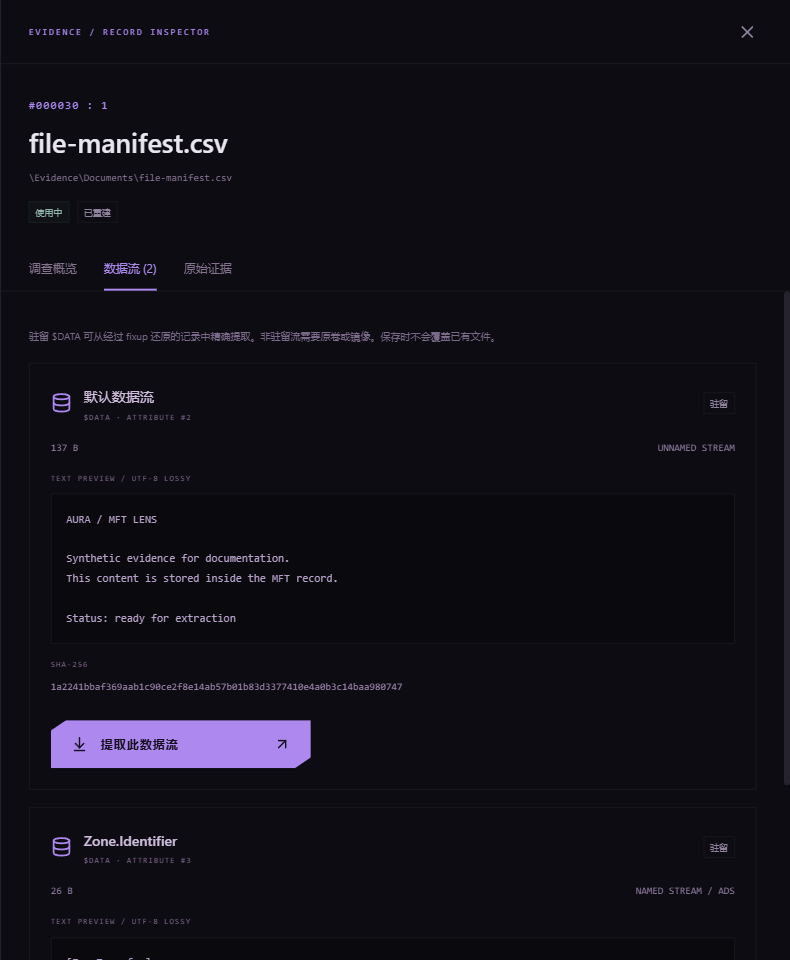 |

### 原始字节追溯

点击属性即可高亮其对应字节，并在输入原始字节与 fixup 还原视图之间切换。

<p align="center">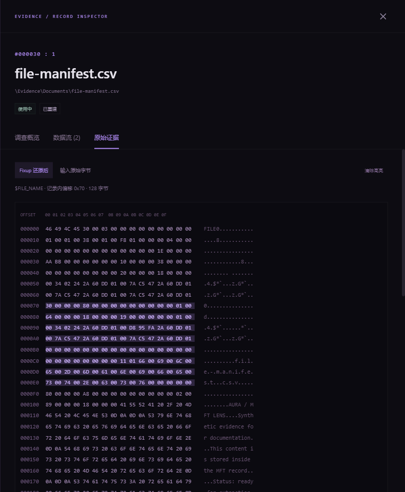</p>

### 深浅主题，随时切换

| 曜石紫 | 午夜蓝 |
| --- | --- |
| 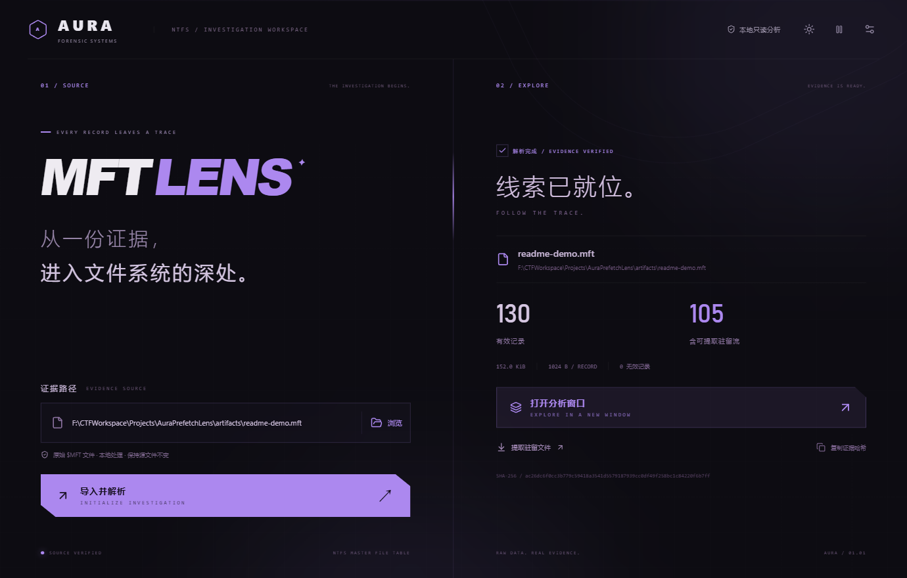 | 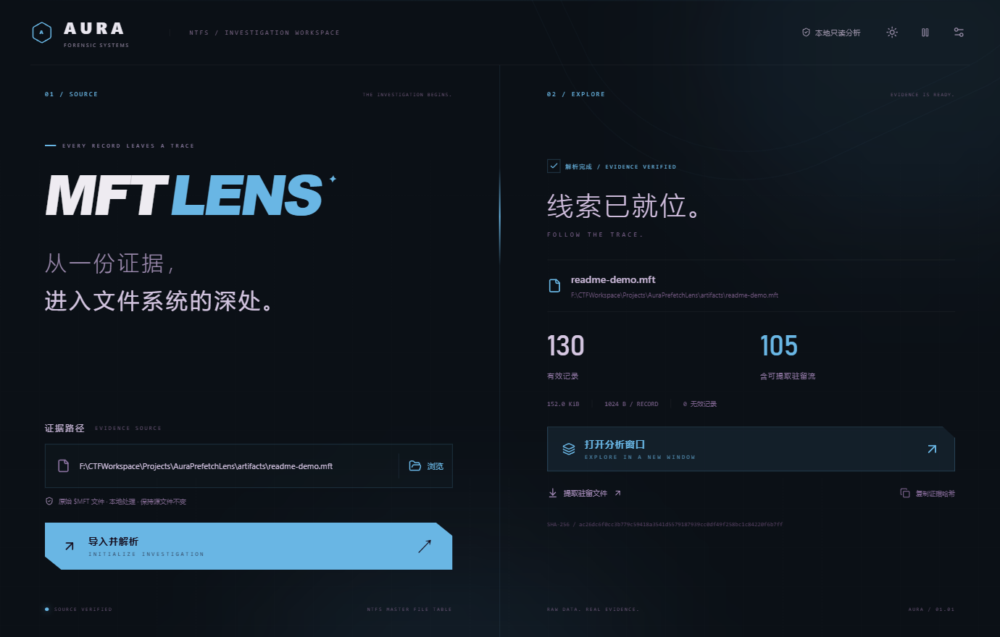 |
| **绯红黑** | **瓷白紫 · 亮色** |
| 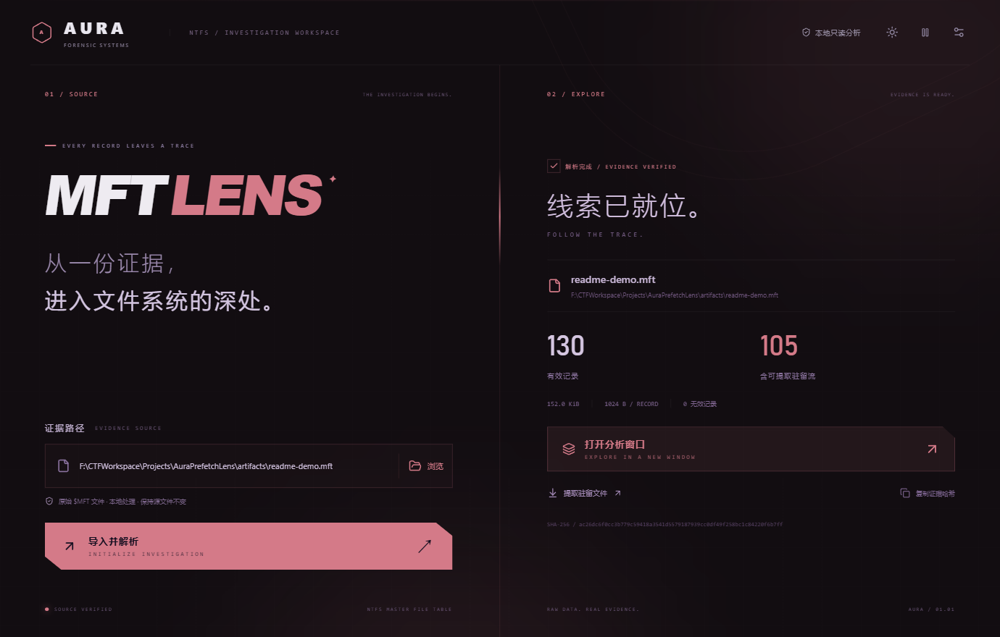 | 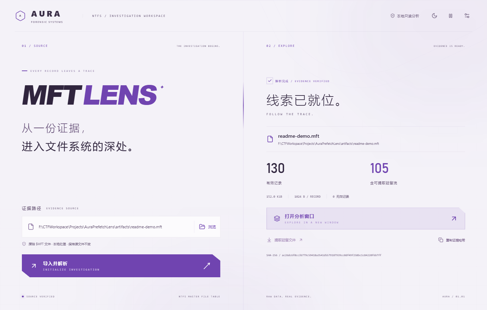 |

亮色主题同时适配主界面、结果列表、详情、十六进制视图和设置面板。

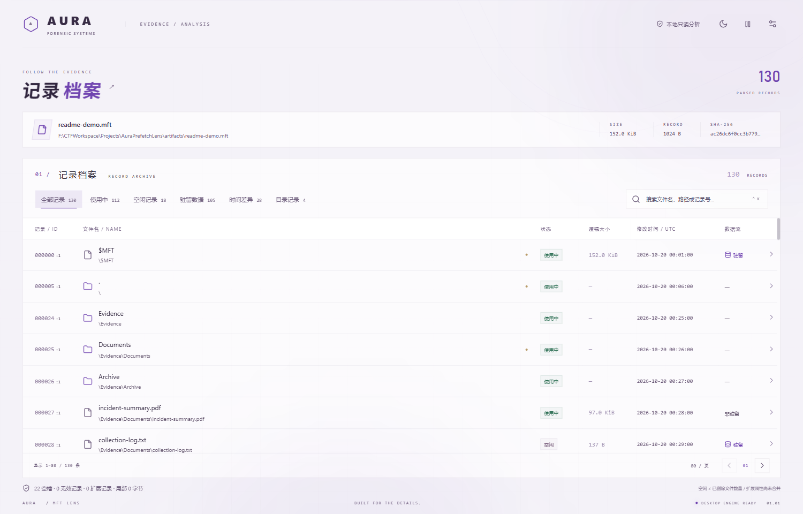

<details>
<summary>查看外观与动效设置</summary>

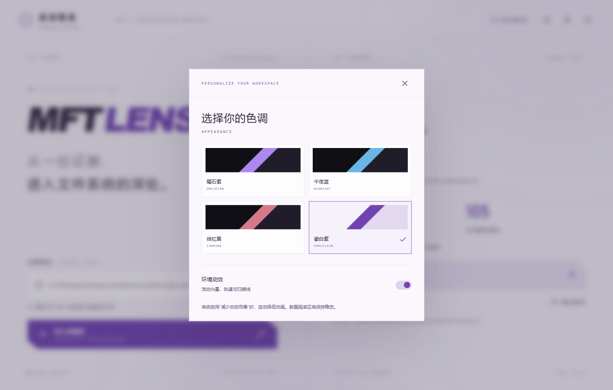

</details>

## 下载与使用

前往 **[Releases 下载最新版本](https://github.com/JasmineAura/AuraPrefetchLens/releases/latest)**。普通使用者不需要安装 Node.js 或 Rust。

| 文件 | 用途 |
| --- | --- |
| `Aura-MFT-Lens-v0.2.0-windows-x64.exe` | 直接运行的 Windows x64 程序 |
| `Aura-MFT-Lens-v0.2.0-windows-x64.zip` | 便携包，包含程序与使用说明 |
| `SHA256SUMS.txt` | 发行文件的 SHA-256 校验值 |

运行环境：**Windows 10 / 11 x64**，需要 [Microsoft Edge WebView2 Runtime](https://developer.microsoft.com/microsoft-edge/webview2/)。发行包不内置 WebView2；如果电脑缺少该运行时，请先安装。

### 开始调查

1. 打开程序，在左侧选择 **$MFT / 文件记录** 或 **$J / USN Journal**，再浏览或粘贴对应的离线文件路径。
2. 点击 **导入并解析**。程序在本地读取证据、计算 SHA-256、校验记录并重建主路径。
3. 完成后自动打开对应的独立结果窗口；主界面右侧也可重新打开。MFT 保留 **提取驻留文件** 入口，USN 提供独立事件分析。
4. 在结果窗口切换 **全部记录 / 使用中 / 空闲记录 / 驻留数据 / 时间差异 / 目录记录** 六个标签。
5. 搜索文件名或主路径；输入纯数字或 `#记录号` 定位特定记录。`Ctrl + K` 聚焦搜索框。
6. 点击记录查看调查概览、数据流或原始证据。`Esc` 关闭详情或设置面板。

程序以普通文件权限读取导出的 MFT，无需通过管理员权限直接访问系统卷。输入文件保持只读，提取时不会覆盖已有目标文件。

## 功能介绍

| 能力 | 当前支持 |
| --- | --- |
| MFT 解析 | 读取原始逻辑 `$MFT`，识别记录大小并进行 USA / fixup 校验 |
| USN Journal | 流式解析原始 `$J` 的 V2.0 / V3.0 / V4.0 记录，跳过零填充并报告异常 |
| 文件活动 | 创建、删除、重命名、数据变化、关闭分类，保留完整 Reason 位掩码 |
| 工件关联 | 手动关联同卷 MFT，以 V2 父引用及序列号推导快照路径 |
| 记录检索 | 后端分页、文件名与主路径搜索、记录号定位、六类筛选 |
| 路径重建 | 校验父引用序列号，标记缺失、循环及失效父引用 |
| 调查卡片 | 记录号、序列号、FN 属性、逻辑大小、来源偏移、属性列表 |
| 时间对照 | SI 与各个 FN 的四组 UTC 时间，保留原始 FILETIME 值 |
| 原始证据 | 输入字节 / fixup 还原字节双视图，点击属性高亮对应范围 |
| 数据流 | 默认流与命名流（ADS）、驻留状态和大小 |
| 驻留提取 | 文本预览、精确字节导出、提取结果 SHA-256 |
| 证据校验 | 输入 SHA-256、空槽、无效记录及扩展记录计数 |
| 独立窗口 | MFT 与 USN 各自保留结果窗口，支持重新打开与证据更新同步 |
| 外观 | 三套深色 + 一套亮色、快捷切换、自动记忆、窗口间同步、可关闭动效 |

### 驻留文件提取

**记录详情 → 数据流 → 提取此数据流**，然后选择一个新的保存文件名。

MFT 记录常见大小为 **1024 字节**，但并非固定值。驻留文件的 `$DATA` 值保存在记录内部，可用空间需要扣除记录头和其他属性。本工具导出实际数据流内容，不包含记录头或属性头。

提取前会还原 USA / fixup 替换的扇区尾部字节，确保跨扇区内容完整；空数据流也可以提取。提取使用当前案例的内存快照，并校验证据哈希，避免更换证据后旧详情误用新案例。

**非驻留内容位于 MFT 外部，需要原卷或磁盘镜像。** 独立 `$MFT` 中只有相关元数据，不能据此恢复完整的非驻留文件。压缩或加密流暂不支持解码提取。

### USN Journal 分析

1. 主界面选择 **$J / USN Journal**，导入导出的原始 `$UsnJrnl:$J` 数据流。仅导入 `$J` 即可查看事件，无需先有 MFT。输入应为 `$J`，而不是 `$Max`、FSCTL API 输出缓冲区或磁盘镜像。
2. 日志窗口支持 **全部事件 / 创建 / 删除 / 重命名 / 数据变化 / 关闭** 六类筛选，以及文件名、关联路径、FRN、USN 和原因关键词搜索。
3. 点击日志查看输入偏移、版本、FRN / PFRN、USN、UTC 时间、Reason、SourceInfo、SecurityId、属性标志和原始字节。
4. 如需路径，在主窗口另行导入 **同一卷** 的 MFT，再回到日志窗口点击 **关联当前 MFT（同卷）**。支持解除关联，原 MFT 分析结果不受影响。

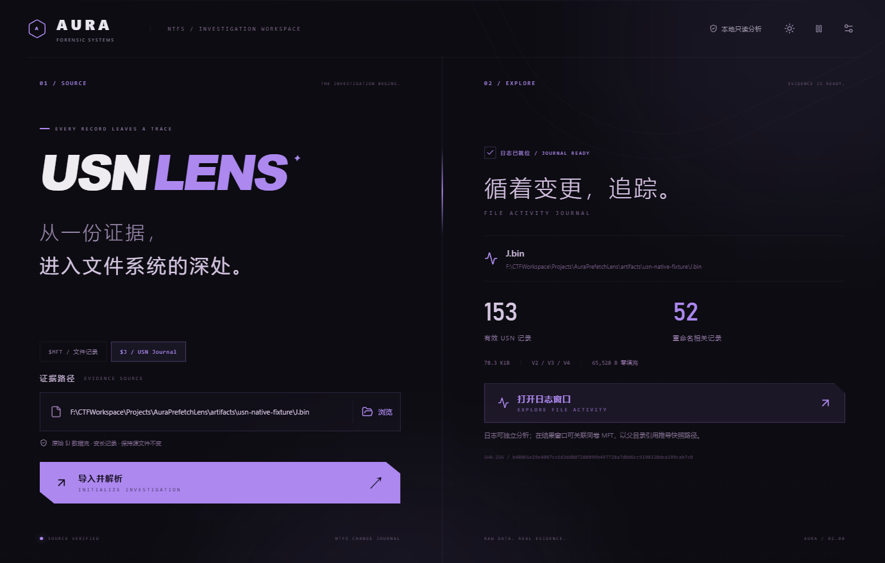

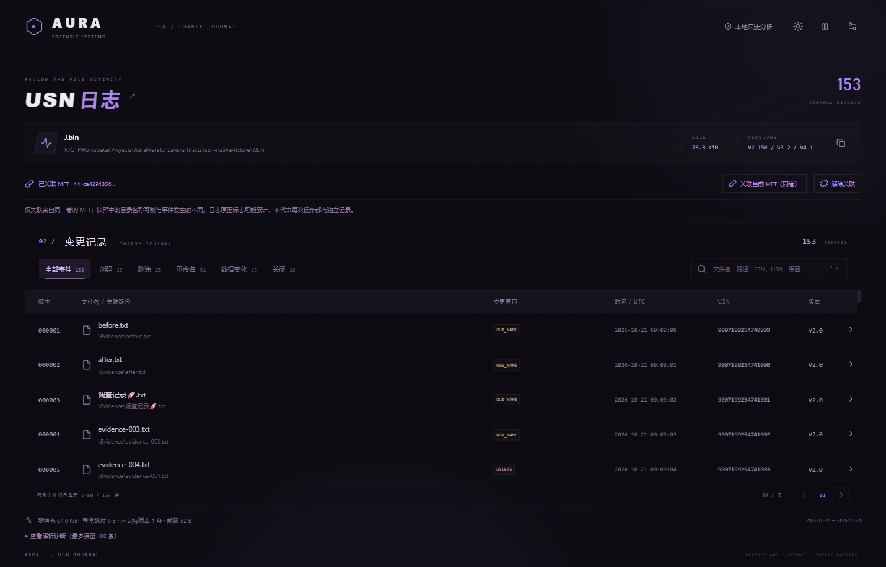

<p align="center">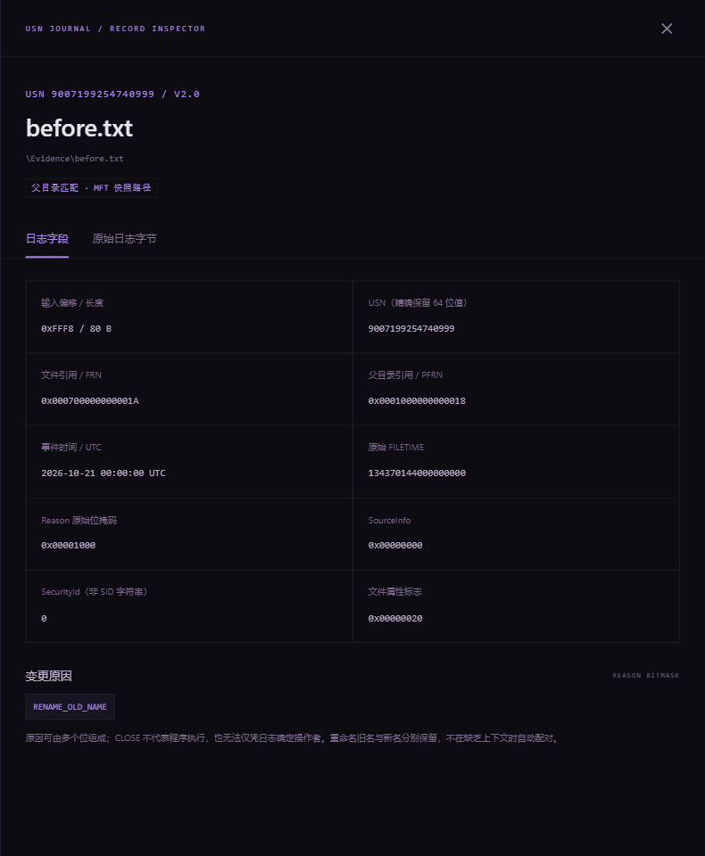</p>

- **V2.0 / V3.0**：变长文件名、UTC 时间和变更原因。V3 的 128 位标识完整保留，不截断后套用 NTFS 64 位引用。
- **V4.0**：保留范围跟踪记录、extent 偏移与长度及 RemainingExtents。V4 本身没有文件名和时间戳，界面明确标记缺失，不从相邻记录猜测，也不自动合并后续范围。
- USN、原始 FILETIME 和文件引用以字符串传递，避免 JavaScript 大整数精度损失。
- 输入按块读取；只保留有效记录与其原始字节，零填充区不常驻内存，但计算输入 SHA-256 仍需要读取整个流。记录很多时，索引仍可能占用较多内存。
- 异常区按 8 字节边界尝试重新同步，报告跳过字节、不支持版本和尾部截断。当前仅支持上述 `.0` 布局，不支持任意损坏雕刻或完整磁盘镜像。
- **关联路径来自 MFT 快照，不保证是事件发生时的历史完整路径。** 父引用序列号失效时不拼接路径；如果文件记录已复用，会保留明确提示。来自不同卷的工件不可关联，程序无法仅凭两个独立文件自动验证卷身份。
- Reason 可同时包含多个标志，统计的是命中标志的记录数；一条记录可能属于多个分类。旧名与新名分别保留，不在缺少上下文时自动配对为单一操作。
- 日志不包含普通文件内容，不能替代驻留数据提取；也无法仅凭它确定操作者、执行进程或保证完整操作历史。
- 当前偏移均相对于导入文件。导出工具如果移除了稀疏区，文件内偏移不等于原卷中的逻辑偏移。

## 当前边界

这是一个持续开发中的早期版本：

- **空闲记录数不等于已删除文件数**，扩展记录也不等于独立文件。
- **SI / FN 时间差异不能单独证明时间戳篡改**；MFT 时间点不等于完整操作历史。
- 扩展记录目前逐条展示，尚未合并 `$ATTRIBUTE_LIST`。主路径选择一个 FN，全部 FN 可在详情查看。
- 无法确认的路径会显式标记，不从独立 MFT 推测原始盘符。坏记录跳过并计数，部分属性解析问题在详情中提示。
- MFT 从首条 `FILE` 记录读取并验证布局；USN 按变长记录解析。不支持磁盘镜像、E01 或任意碎片雕刻输入。
- 当前采用内存索引并保留输入字节，总内存占用高于文件大小。尚无案例持久化、CSV 导出、LogFile 分析和快照对比。

## 从源码运行

### 开发环境

- Node.js 22 或更新的兼容版本、npm。
- Rust stable（Windows MSVC 工具链）。
- Visual Studio C++ Build Tools / Windows SDK。
- Microsoft Edge WebView2 Runtime。

```powershell
git clone https://github.com/JasmineAura/AuraPrefetchLens.git
cd AuraPrefetchLens
npm ci
npm run tauri dev
```

`npm run dev` 只启动浏览器预览。真实解析、独立原生窗口及文件保存需要 Tauri 桌面端。

### 构建发行版

构建前请退出正在运行的本项目程序。

```powershell
# 编译程序并生成便携包与校验值
powershell -File .\scripts\build-release.ps1
```

产物位于 `artifacts/release/v0.2.0/`。也可以仅编译程序：

```powershell
npx tauri build --no-bundle
```

可执行文件位于 `src-tauri/target/release/aura-mft-lens.exe`。

### 运行检查

```powershell
npm run build
cargo test --manifest-path src-tauri/Cargo.toml -- --nocapture
npm test
```

Rust 测试覆盖跨扇区驻留提取、4096 字节记录、扇区损坏、属性越界及截断输入。真实证据测试在本地样例存在时运行，**原始证据不随源码或发行包分发**。

新增 `npm run test:usn`：通过本地 WebView2 调试端口验证独立 $J 导入、事件检索、MFT 关联、V3/V4、原始字节及精确大整数。所需 USN 和 MFT 夹具由脚本自动生成，不需要真实证据。

界面测试使用本机 Microsoft Edge。`npm run test:native` 可通过本地 WebView2 调试端口验证实际导入、独立结果窗口、主题同步、分类搜索、驻留落盘和源字节一致性。该脚本需要本地测试证据；调试端口不是发行配置。

### 项目结构

```text
src/                   React 界面、主题与交互
src-tauri/src/mft.rs    MFT 解析、路径重建、驻留提取
src-tauri/src/usn.rs    USN V2/V3/V4 解析与同卷 MFT 快照关联
src-tauri/src/main.rs   Tauri 命令、案例状态与窗口管理
scripts/               发行打包与桌面验证脚本
tests/                 界面测试
docs/images/           界面截图与打赏二维码
```

## 反馈与贡献

欢迎在 [Issues](https://github.com/JasmineAura/AuraPrefetchLens/issues) 提交问题和建议。报告解析问题时，请提供版本号、记录大小、错误信息和可复现的脱敏记录，避免直接上传包含私人文件名或内容的原始证据。

## 打赏作者

如果这个工具帮你节省了排查时间，欢迎请作者喝杯咖啡，支持后续开发与维护。**打赏完全自愿，不影响现有功能使用。**

<div align="center">
  
  <p>微信扫码 · 感谢支持 JasmineAura</p>
</div>

## 致谢

基于 [Tauri](https://tauri.app/)、[React](https://react.dev/)、[Vite](https://vite.dev/) 和 [Lucide](https://lucide.dev/)。NTFS 结构参考 [Microsoft 文件记录头说明](https://learn.microsoft.com/windows/win32/devnotes/file-record-segment-header) 与 [属性记录头说明](https://learn.microsoft.com/windows/win32/devnotes/attribute-record-header)。USN 布局参考 Microsoft [V2](https://learn.microsoft.com/windows/win32/api/winioctl/ns-winioctl-usn_record_v2)、[V3](https://learn.microsoft.com/windows/win32/api/winioctl/ns-winioctl-usn_record_v3)、[V4](https://learn.microsoft.com/windows/win32/api/winioctl/ns-winioctl-usn_record_v4) 文档。
